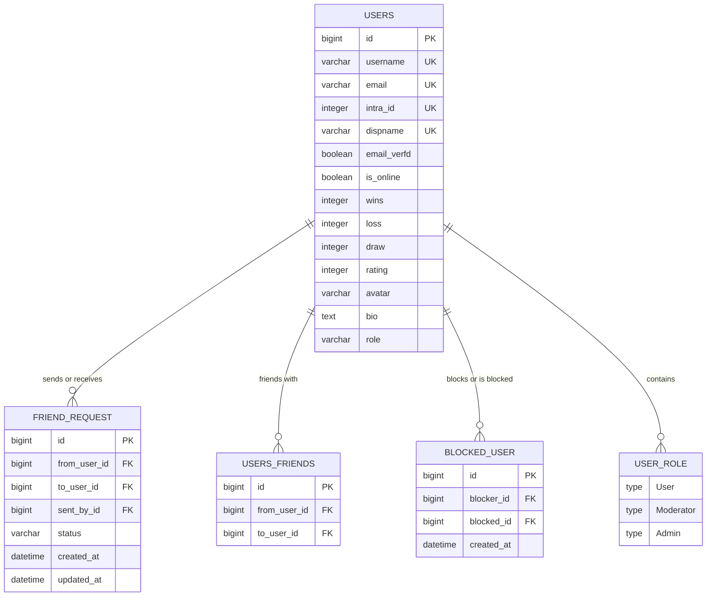
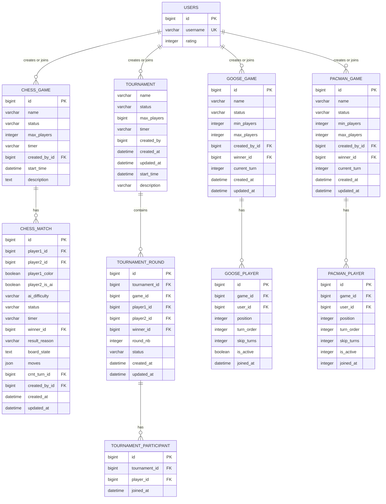
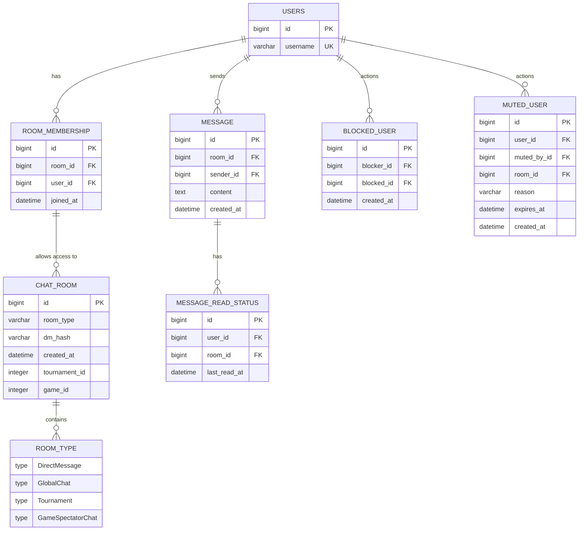

*This project has been created as part of the 42 curriculum by alephoen, isadbaib, bvan-duy and mtice.*

# Born2Transcend

## Description

Born2Transcend is a full-stack web application which hosts and serves a chess game, a multiplayer Pacman game, Goose game, global and private chat. The chess game allows you to learn chess in practice mode against an AI, chat to a dedicated AI chess coach, play against your friends remotely and play in tournaments. The Pacman multiplayer game is a fresh take on the traditional Pacman game, where you can play with multiple friends remotely, and fight some powerful ghosts! The old classic Goose game with a fun twist. Adding a Wizard chasing players around and asking them questions once a player is caught. If the player fails to answer three question in a row they might end-up in prison for a few rounds.

Besides the awesome entertainment it provides, Born2Transcend aims to seamlessly service a secure website with fluid UX and an intuitive UI. The back-end is split into loosely-coupled micro-services, launched with Docker to increase the scalability of the project, and the security of launching several dependencies. The database in PostgreSQL is managed via an ORM in Django, to handle CRUD, and prevent SQL-injection security risks. The website is served by Nginx through HTTPS and WAF/ModSecurity, with an SSL certificate and TLSv1.3 protocol. Security is further enhanced with remote authentication with OAuth 2.0, 2FA, ModSecurity with HashiCorp vault for Secrets. The gaming and UX are enhanced by the remote multiplayer user experience, tournaments, a variety of user-to-user actions (invitations, friending, chatting), and a complete LLM chess coach interface. A minimalist, but intuitive UI is built with React, and uses a dark colour theme with readable font, can be accessed both on computers and mobiles, with a visible links to the license and Terms and Conditions of use.

Born2Transcend is operating under the GNU GPL v3 license. Consult it [here](/important_md/LICENSE.md)

---

## Instructions

#### Pre-requisites
* Access to `sudo` rights (otherwise consider launching within a VM)
* Docker with the `compose` and `buildx` plugins (latest version recommended)
* make, virtualbox, socat, npm, sfw for npm, NodeJs version 20 or above
* Defined environment variables in a `.env` and `.env.secrets.enc` file at the root of the repository

#### Usage without Virtual Machine
```bash
git clone <url> Born2Transcend
cd Born2Transcend
cp $path/.env   # You can check .env.example
cp $path/.env.secrets.enc
cat << EOF > /sys/class/dmi/id/product_name
> <your_hostname>
> EOF
make build #or just call make and choose your option
```

#### Usage with Virtual Machine
On the host PC:
```bash
vboxmanage list vms # Choose your VM
# Check your VM's firmware type:
VBoxManage showvminfo "<vm_name>" | grep -i firmware
# For BIOS VMs:
VBoxManage setextradata "<vm_name>" VBoxInternal/Devices/pcbios/0/Config/DmiSystemProduct "$(hostname)"
# For EFI VMs:
VBoxManage setextradata "<vm_name>" VBoxInternal/Devices/efi/0/Config/DmiSystemProduct "$(hostname)"
# Check that the data you entered is correct
VBoxManage getextradata "<vm_name>" enumerate
# Then restart the VM (the hostname is applied at boot time)
```

Within the VM:
```bash
# Check that you have correctly set the hostname
cat /sys/class/dmi/id/product_name
git clone <url> Born2Transcend
cd Born2Transcend
cp $path/.env   # You can check .env.example
cp $path/.env.secrets.enc
```

#### Docker Networking (nftables fix)

Docker 29.8.0+ may fail to create firewall rules when using the default
`iptables` firewall backend, resulting in containers with no internet
connectivity (DNS timeouts, 100% packet loss). This happens because Docker's
iptables-legacy integration can lose its own chains during bridge network
initialization, silently preventing all outbound traffic from containers.

The fix is to switch Docker to the `nftables` firewall backend. Install
`nftables` using your distribution's package manager, then set
`/etc/docker/daemon.json`:
```json
{"dns": ["8.8.8.8", "1.1.1.1"], "firewall-backend": "nftables"}
```

Then restart the Docker service.


Go to https://<server-ip>:4443 or https://<server_hostname>:4443 and accept certificate.


#### User-Experience
This web application is compatible with Firefox, Brave, Chrome, Chromium, and Edge, as well as iOS and Android. Some features may be browser specific, such as colours, icons and emojis. Nevertheless, the global user experience remains largely the same throughout OS and browser. This app was largely developed and tested on Firefox and Brave browsers, and later adapted to serve a wider range of browsers.

#### Alternative build methods

| Action | Command |
|:-------|:--------|
| Build an start the service | make |
| Stop the service | make stop |
| Restart the service | make restart |
| Remove containers and volumes | make clean |
| Remove the whole web application and purge all system files, including stored data | make fclean |
| Purge system and re-build from scratch | make re |
| Check status of containers | make ps |

---

## Resources

#### References and Documentation

| Resource | Relevance |
|:---------|:------------|
| [A Beginner's Guide to NGINX](https://nginx.org/en/docs/beginners_guide.html) | Managing and setting up the back-end |
| [Stockfish AI - Documentation](https://official-stockfish.github.io/docs/stockfish-wiki/Home.html) | LLM Chess Coach feature |
| [PostgreSQL Tutorial](https://www.w3schools.com/postgresql/index.php) | SQL and Database Management |
| [GDPR Rights Under EU Law](https://gdpr.eu/data-privacy/) | GDPR features |
| [Writing A React App From Scratch](https://react.dev/learn/build-a-react-app-from-scratch) | Framework for Front-end: React |
| [Getting Started with Django](https://www.djangoproject.com/start/) | Framework for Back-end: Django |


#### AI Usage
AI was used as an assistant in building this project. AI was used in the scope of:
* Context-specific research. I.e.:
	* To identify which frameworks for front-end and back-end would be most useful in the context of the project
	* To identify best practices for development and deployment, in order to craft a Service that is robust and secure.
* Context-specific debugging. I.e.:
	* Testing, and adapting the Project towards being as software and hardware agnostic possible
* Testing
	* Develop mock tests, to help test initial functionalities, before integrating the code, as part of the CI/CD pipeline.

`NOTE:` At no point was AI allowed to independently write code without supervision, or make significant changes to the project structure. AI was used to assist with research, and with debugging, when existing forums could not supply the information needed.

---

## Team Information

#### Team Roles and Responsibilities

|Role                        | Name    | ID       | Domain                     |
|:---------------------------|:--------|:---------|:---------------------------|
|Product Owner + Developer   | Alex    | alephoen | Django Backend, PostgreSQL, WebSockets, Docker, Nginx, Grafana and Prometheus, User interaction, React Frontend, Tailwind CSS|
|Project Manager + Developer | Matilda | mtice    | Tailwind CSS, React Frontend, GDPR-compliance, Documentation |
|Tech Lead + Developer       | Bram    | bvan-duy | 6-language Translation, RTL language support, ELK for logs, React Frontend, Tailwind CSS, Project-wide testing, and bug reporting|
|Developer + DevOps          | Ismail  | isadbaib | Multiplayer-games, Django Backend, React Frontend, TailwindCSS |

#### Definition of Team Roles
**Product Owner:** Defines the product vision, maintains the backlog, makes feature priority decisions, validates completed work, and communicates with evaluators. Owns the product - not the code.

**Project Manager / Scrum Master:** Organises team meetings, tracks progress and deadlines, ensures communication flows, manages risks and blockers. Monitors all branches in the central repo for progress.

**Tech Lead / Architect:** Defines and enforces the technical architecture. Makes technology stack decisions. Reviews critical code changes. Owns the arbitration process for disputed bugs. Reviews and approves all interface contracts before development begins.

**Developers (all):** Write code for assigned features only. Participate in code reviews. Test their own implementations. Write tests in English. Document their work.

---

## Project Management

#### Team Organisation
**Product Owner:** Envisioned the final project and decided the project structure. Set up the foundational skeleton of the project. Built the back-end as micro-services using Docker. Connected the back-end and database via an ORM, and established links to services from the front-end to the back-end via WebSockets.

**Project Manager / Scrum Master:** Facilitated inter-team communication and wrote documentation for the project. Oversaw consumer-facing features, such as the front-end and GDPR-compliance features. 

**Tech Lead / Architect:** Tested, and evaluated the project's progress. Kept a close log of bugs, tracked new features and provided feedback. 

**Developers:** All team members also took on the role of developer, writing code for each assigned feature. Frequent updates, demonstrations, and code reviews took place in person, with at least another team member. Team-wide updates once a feature was ready were made through the team chat in Slack.

#### Project Management
Effective project management was achieved in three ways: 
1. **Regular in-person meetings**  
	1.1. Discussions, debugging sessions and testing sessions
2. **Constant communication in Slack**  
	2.1. Regular team updates, Q&As and peer reviews of drafts  
	2.2. Communication was facilitated via Slack or in-person on campus
3. **GitHub issues**
    1.1. For bug reporting and technical discussions between team members.
4. **GitHub pull requests**  
	3.1. GitHub pull requests and separate branches allowed for effective monitoring of the workflow, recording new features, and facilitated damage control in the event of an issue in development


---

## Technical Stack

| Layer | Framework | Justification |
|:------|:----------|:--------------|
|Front-end | React | React is component-based, which mirrors our approach to serving the back-end as micro-services. React also uses a virtual DOM which rapidly communicates changes in code to the DOM via a diffing algorithm. A modular approach to the front-end facilitates scalability and the Virtual DOM facilitates efficient development.|
|Back-end | Django | Django's native ORM features made it a perfect contender for combining with our PostgresSQL database. Additionally, Django is built for traffic-intensive websites, and already comes with a lot of native tools such as authetication, session handling, database interaction, XSS protection, and SQL injection protection. The documentation was also a big plus.|
|ORM | Django + PostgreSQL | Django supports PostgreSQL-specific features. Django's ORM uses parameterised SQL, preventing SQL injection, adding an extra layer of security. |
|Database | PostgreSQL |Open-source, with good documentation. ACID-compliant. Good JSON support. Scales well. Efficient with complex relational applications, with recursive API calls.|
|Deployment | Docker + Nginx with Alpine Linux | Deployment with docker, useful for containing each service separately, and correctly deploying each service with dependencies and health checks for maximum efficiency and safety during the launching process. Nginx served the service, for its ability to launch with SSL certificates and TLS protocols. Linux Alpine was used as the default OS, as its an ultra-lightweight and secure Linux distro.|
|Monitoring System | Prometheus + Grafana | Open source, and good documentation. Good support for containerised services. |
|AI Chess Player | Stockfish AI | Open-source. AI development specifically for playing chess. Possibility of different difficulty levels. |
|LLM Chess Coach | Ollama + MistralAI | Using Ollama to run the mistral AI model. Both Ollama and Mistral are focused on data privacy and mostly open-sourced |

---

## Database Schema
**PK:** Primary key  
**FK:** Foreign key  
**UK**: Unique Key  

### Users and social features



### Games and Tournaments


### Chat system

---

## Features List

| Feature | Description | 
|:--------|:------------|
| User interaction | Users are able to friend, and chat with other users. Users can invite friends to tournaments |
| Real-time WebSockets | Django Channels with Redis pub/sub powers real-time communication across chat, games, and notifications |
| Complete notification system | Full CRUD notifications with real-time delivery via WebSockets |
| Advanced permissions system | Admin, Moderator, and User roles with full CRUD management |
| LLM Chess Coach | Users can talk to an LLM (Mistral AI via Ollama) which is specialised in chess. This provides a unique learning experience tailored to each user's needs |
| Tournaments | Users can test their skills competitively by participating in tournaments. AI players fill in when not enough users join |
| AI Chess Player | Users can battle against an AI (Stockfish), with varying levels of difficulty. AI players are also able to play amongst themselves, whenever necessary in a tournament |
| OAuth and 2FA | Users have the ability to sign in via Google or 42 OAuth, with optional TOTP-based 2FA via Authenticator App |
| Player stats and gamification | Players can view their stats, leaderboards, achievements, badges, and XP/level progression |
| User activity analytics | Dashboard with Recharts visualisations, date filters, and CSV/PDF export |
| User roles | Users may have different roles, such as "Moderator" or "Admin" to monitor and manage other users |
| Multiplayer games | The Goose game and the re-imagined multiplayer Pacman are both multiplayer games, which can handle a flexible number of players. Player roles in the Pacman game can be customised |
| Advanced 3D graphics | 3D Pacman via pygbag/WASM and Three.js |
| Game customization | Power-ups, maps, and custom game settings |
| Spectator mode | Watch ongoing games with real-time updates |
| Advanced chat features | Block users, invite from chat, notification history, and real-time chat translation via DeepL |
| 6 languages | The web-application supports 6 languages: English, French, Dutch, Arabic, Hebrew, and Klingon |
| RTL language support | The web-application supports RTL languages (Arabic, Hebrew) with full layout mirroring |
| Data export and import | JSON, CSV, and XML export/import with validation |
| GDPR compliance | Players can request to download their data and delete their account with email confirmation |
| Security audit log | Audit model with auto-lock after 5 failed attempts, admin unlock, and demo script |
| Intrusion detection | fail2ban log analysis (unprivileged) communicating via Unix socket to a privilege-separated firewall agent with CAP_NET_ADMIN for DOCKER-USER iptables rules |
| Health checks and backups | Docker healthchecks on all services, automated restic backups |
| Monitoring | Prometheus + Grafana with custom dashboards, nginx/postgres/redis exporters, and alerting via Alertmanager |
| Collaborative whiteboard | Real-time collaborative drawing via WBO |

---

## Scalable Architecture: Micro-services and Django as an API gateway
The back-end of this application is structured as separate, independently deployable services, deployed by docker compose:

| Name | Function |
|:-----|:---------|
| backend_django | web application + API |
| chess_engine | C++ move validation (REST API on port 4190) |
| stockfish_ai | AI opponent (REST API on port 4191) |
| timeout_checker | game clock enforcement (REST API) |
| vault + vault_init | secrets management (HashiCorp Vault with AppRole auth) |
| postgres | database (PostgreSQL) |
| redis | cache + pub/sub (message queue for WebSockets) |
| frontend_nginx | reverse proxy + WAF/ModSecurity + static serving |
| whiteboard | collaborative drawing (WBO, separate app) |
| mailpit | email service |
| backup | automated restic backup service |
| ollama | LLM chess coach (Mistral AI) |
| prometheus | metrics collection |
| grafana | monitoring dashboards |
| alertmanager | alert routing for Prometheus |
| nginx-exporter | nginx stub_status metrics for Prometheus |
| postgres-exporter | PostgreSQL metrics for Prometheus |
| redis-exporter | Redis metrics for Prometheus |
| fail2ban | log analysis — unprivileged, communicates via Unix socket |
| firewall-agent | privilege-separated firewall agent (CAP_NET_ADMIN, DOCKER-USER iptables) |

Additionally, Django apps that constitute the chat, chess coach, chess game, goose game, pacman game, and tournaments, are loosely coupled with clear interfaces. Each app has its own models, views, URLs, and consumers. They communicate through Django's ORM and the redis channel layer. The chess coach, chess game, and timeout checker apps are genuine micro-services with REST APIs.

---

## Modules

|Status | Module                   | Type      | Points  | Category      | Description       | Developer              |
|:------|:-------------------------|:----------|:--------|:--------------|:------------------|:-----------------------|
| ✅ | Use a framework for frontend and backend | Major | 2 | Web | React for the front-end framework and Django for the backend framework | alephoen |
| ✅ | Real-time features using WebSockets | Major | 2 | Web | Django Channels with Redis pub/sub for real-time communication | alephoen |
| ✅ | User interaction (chat, profiles, friends) | Major | 2 | Web | Users can interact via DM, global chat, friend requests, and match invites. Public profiles viewable by other users | alephoen |
| ✅ | Public API with secured key (5+ endpoints) | Major | 2 | Web | REST API, rate limited, documented | alephoen |
| ✅ | Use an ORM for the database | Minor | 1 | Web | Django ORM with PostgreSQL | alephoen |
| ✅ | Complete notification system | Minor | 1 | Web | Full CRUD notifications with real-time delivery | alephoen |
| ✅ | Real-time collaborative features | Minor | 1 | Web | Whiteboard (WBO) for real-time collaborative drawing | alephoen |
| ✅ | Support for multiple languages (6) | Minor | 1 | Accessibility | EN, FR, NL, AR, HE, Klingon | bvan-duy |
| ✅ | RTL language support | Minor | 1 | Accessibility | Arabic, Hebrew — full layout mirroring | bvan-duy |
| ✅ | Support for additional browsers | Minor | 1 | Accessibility | Firefox, Brave, Chrome, Edge, iOS, Android | alephoen |
| ✅ | Standard user management and authentication | Major | 2 | User Management | Profiles, avatars, friends, online status | mtice |
| ✅ | Advanced permissions system | Major | 2 | User Management | Admin, Moderator, User roles — full CRUD management | alephoen |
| ✅ | Game statistics and match history | Minor | 1 | User Management | Stats, leaderboards, achievements | mtice |
| ✅ | Remote authentication with OAuth 2.0 | Minor | 1 | User Management | Google + 42 OAuth, automatic account creation | alephoen |
| ✅ | Complete 2FA system | Minor | 1 | User Management | TOTP via Authenticator App | alephoen |
| ✅ | User activity analytics dashboard | Minor | 1 | User Management | Recharts visualisations, date filters, CSV+PDF export | alephoen |
| ✅ | AI Opponent for games | Major | 2 | AI | Stockfish AI with multiple difficulty levels. AIs can face each other in tournaments | alephoen |
| ✅ | LLM system interface | Major | 2 | AI | Ollama serves Mistral AI as a chess coach | alephoen |
| ✅ | WAF/ModSecurity + HashiCorp Vault | Major | 2 | Cybersecurity | OWASP CRS, Vault AppRole, TLS | alephoen |
| ✅ | Web-based game (users vs each other) | Major | 2 | Gaming & UX | Chess — 1v1, live matches, rules engine | alephoen |
| ✅ | Remote players in real-time | Major | 2 | Gaming & UX | WebSocket sync across devices | isadbaib |
| ✅ | Multiplayer game (3+ players) | Major | 2 | Gaming & UX | Pacman + Goose Game, variable number of players | isadbaib |
| ✅ | Another game + matchmaking | Major | 2 | Gaming & UX | Goose Game — match history, matchmaking | isadbaib |
| ✅ | Advanced 3D graphics | Major | 2 | Gaming & UX | 3D Pacman via pygbag/WASM, Three.js | isadbaib |
| ✅ | Advanced chat features | Minor | 1 | Gaming & UX | Block, invite from chat, notifications, history | alephoen |
| ✅ | Tournament system | Minor | 1 | Gaming & UX | Brackets, matchmaking, AI fill-in | alephoen |
| ✅ | Game customization options | Minor | 1 | Gaming & UX | Power-ups, maps, custom settings | isadbaib |
| ✅ | Gamification system | Minor | 1 | Gaming & UX | Achievements, badges, XP/levels | mtice |
| ✅ | Spectator mode for games | Minor | 1 | Gaming & UX | Watch ongoing games, real-time updates | isadbaib |
| ✅ | Monitoring: Prometheus + Grafana | Major | 2 | DevOps | Custom dashboards, nginx/postgres/redis exporters, alerting via Alertmanager | alephoen |
| ✅ | Backend as microservices | Major | 2 | DevOps | Docker Compose, REST APIs, message queues | alephoen |
| ✅ | Health checks + automated backups | Minor | 1 | DevOps | Docker healthchecks on all services, restic backups | alephoen |
| ✅ | Advanced analytics dashboard | Major | 2 | Data & Analytics | Recharts, real-time, export PDF/CSV | alephoen |
| ✅ | Data export and import | Minor | 1 | Data & Analytics | JSON, CSV, XML + validation | alephoen |
| ✅ | GDPR compliance features | Minor | 1 | Data & Analytics | Data request, deletion, export, email confirmation | alephoen |
| ✅ | Security audit log & intrusion detection | Major | 2 | Custom | Audit model, auto-lock after 5 failed attempts, admin unlock, demo script | alephoen |
| ✅ | fail2ban + privilege-separated firewall agent | Major | 2 | Custom | Unprivileged fail2ban → Unix socket → CAP_NET_ADMIN agent, DOCKER-USER iptables | alephoen |
| ✅ | Real-time chat translation (DeepL) | Minor | 1 | Custom | On-demand per-message translate, REST API, secrets via file mount | alephoen |

**Total: 32 modules — 18 Major, 14 Minor — 57 Points**

`NOTE:` Infrastructure for log management using ELK (Elasticsearch, Logstash, Kibana) was implemented by the team but a decision was made to remove it because the school machines lacked the necessary resources (8GB RAM limitation).

---

## Individual contributions

Individual contributions are highlighted in the `Modules` section above. Note: all developers shared responsibility and contributed to the project as a whole. Features may have been shared by more than one developer.  

|Name | Contributions |
|:----|:--------------|
|alephoen | Chess game, chess tournaments, chess coach, whiteboard service. Managing the backend as microservices with Docker, setting up the Django backend framework, and the ORM with the PostgreSQL database. WebSocket real-time features with Django Channels and Redis. Security features: OAuth 2.0, 2FA, WAF/ModSecurity, HashiCorp Vault, security audit log with intrusion detection, fail2ban with privilege-separated firewall agent. Public REST API. Advanced permissions system. Complete notification system. Advanced chat features with real-time DeepL translation. User activity analytics dashboard. Advanced analytics dashboard with Recharts. Data export/import. GDPR compliance. Health checks and automated restic backups. Prometheus + Grafana monitoring with exporters and Alertmanager. Front-end React and Tailwind CSS. |
|isadbaib | Pacman multiplayer game with advanced 3D graphics (pygbag/WASM, Three.js), Goose game with matchmaking, remote real-time multiplayer via WebSockets, game customization options, spectator mode. Front-end React and Tailwind CSS, support for multiple browsers and mobile. |
|bvan-duy | Front-end React and Tailwind CSS, 6-language translation, RTL language support (Arabic, Hebrew). Project-wide testing, reviewing, and bug reports. |
|mtice | Front-end React and Tailwind CSS, standard user management and authentication, game statistics and match history, gamification system (achievements, badges, XP/levels), documentation, GDPR regulations. Communication and team management. |


#### Challenges
We faced a few limitations due to the computer hardware at our school, such as:
* Log management with ELK lagged due to the 8GB ram
* Limited space on school computers meant that logs, backups, and monitoring activity had to be limited

