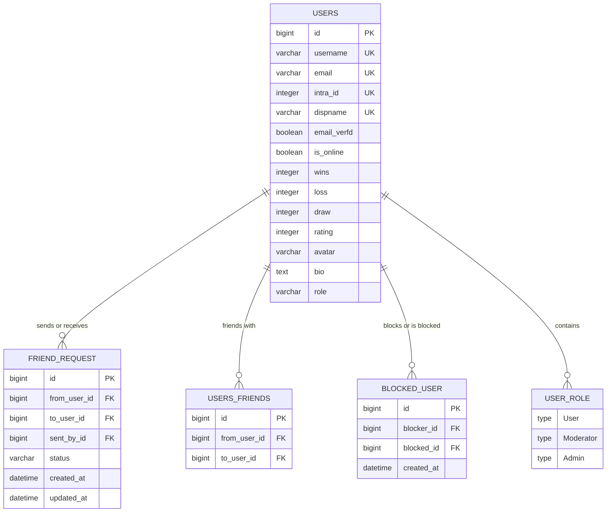
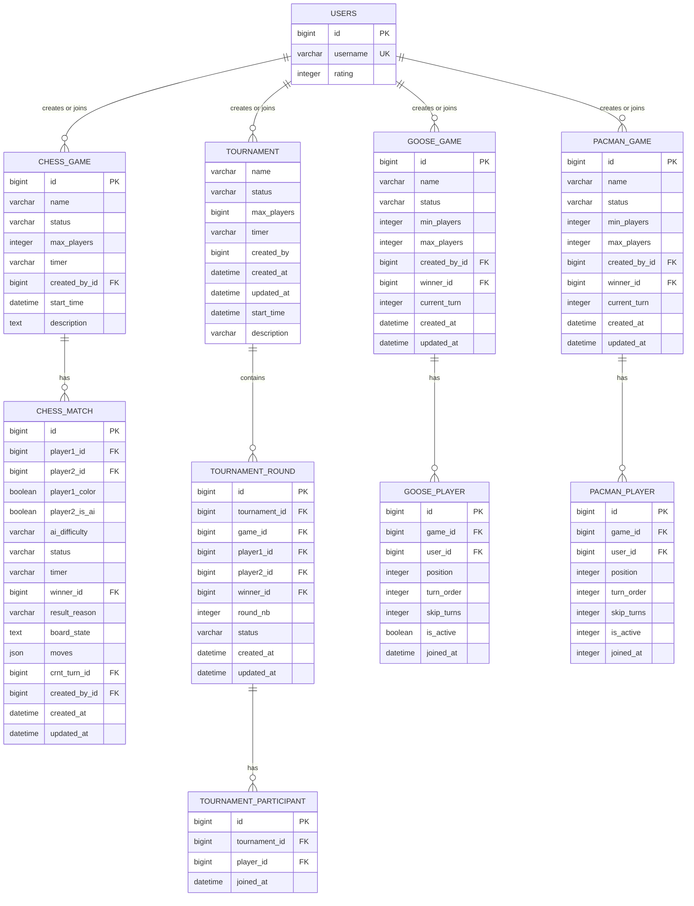
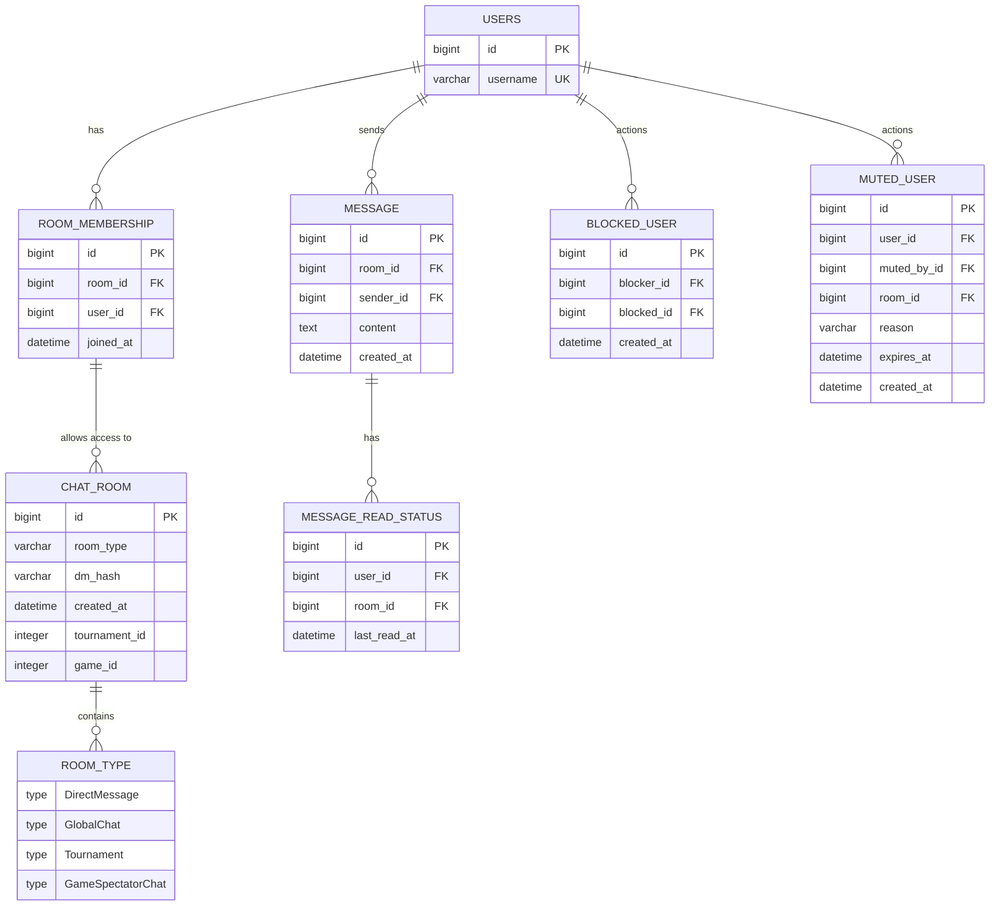

*This project has been created as part of the 42 curriculum by alephoen, isadbaib, bvan-duy and mtice.*

# Born2Transcend

## Description

Born2Transcend is a full-stack web application which hosts and serves a chess game and a multiplayer Pacman game. The chess game allows you to learn chess in practice mode against and AI, chat to a dedicated AI chess coach, play against your friends remotely and play in tournaments. The Pacman multiplayer game is a fresh take on the traditional Pacman game, where you can play with multiple friends remotely, and fight some powerful ghosts!

Besides the awesome entertainment it provides, Born2Transcend aims to seamlessly service a secure website with fluid UX and an intuitive UI. The back-end is split into loosely-coupled micro-services, launched with Docker to increase the scalability of the project, and the security of launching several dependencies. The database in PostgreSQL is managed via an ORM in Django, to handle CRUD, and prevent SQL-injection security risks. The website is served by Nginx through HTTPS, with an SSL certificate with a TLSv1.3 protocol. Security is further enhanced with remote authentication with OAuth 2.0, 2FA, ModSecurity with HashiCorp vault for Secrets. The gaming and UX are enhanced by the remote multiplayer user experience, tournaments, a variety of user-to-user actions (invitations, friending, chatting), and a complete LLM chess coach interface. A minimalist, but intuitive UI is built with React, and uses a dark colour theme with readable font, and a visible links to the license and Terms and Conditions of use.

Born2Transcend is operating under the GNU GPL v3 license. Consult it [here](/docs/LICENSE.md)

---

## Instructions

#### Pre-requisites
* Access to `sudo` rights (otherwise consider launching within a VM)
* Docker and docker compose (latest version recommended)
* make, socat, npm, sfw for npm, NodeJs version 20
* Defined environment variables in a `.env` and `.env.secrets.enc` file at the root of the repository

#### Usage
```bash
git clone <url> Born2Transcend
cd Born2Transcend
cp $path/.env   # You can check .env.example
cp $path/.env.secrets.enc
make build #or just call make and choose your option
```
`Go to https://<server-ip>:4443 and accept certificate.`

#### Other commands

| Action | Command |
|:-------|:--------|
| Build an start the service | make |
| Stop the service | make stop |
| Restart the service | make restart |
| Remove containers and volumes | make clean |
| Remove the whole web application and purge all system files, including stored data | make fclean |
| Purge system and re-build from scratch | make re |
| Check status of containers | make ps |


---

## Resources

#### References and Documentation

| Resource | Relevance |
|:---------|:------------|
| [A Beginner's Guide to NGINX](https://nginx.org/en/docs/beginners_guide.html) | Managing and setting up the back-end |
| [Stockfish AI - Documentation](https://official-stockfish.github.io/docs/stockfish-wiki/Home.html) | LLM Chess Coach feature |
| [PostgreSQL Tutorial](https://www.w3schools.com/postgresql/index.php) | SQL and Database Management |
| [GDPR Rights Under EU Law](https://gdpr.eu/data-privacy/) | GDPR features |
| [Writing A React App From Scratch](https://react.dev/learn/build-a-react-app-from-scratch) | Framework for Front-end: React |
| [Getting Started with Django](https://www.djangoproject.com/start/) | Framework for Back-end: Django |


#### AI Usage
AI was used as an assistant in building this project. AI was used in the scope of:
* Context-specific research. I.e.:
	* To identify which frameworks for front-end and back-end would be most useful in the context of the project
	* To identify best practices for development and deployment, in order to craft a Service that is robust and secure.
* Context-specific debugging. I.e.:
	* Testing, and adapting the Project towards being as software and hardware agnostic possible
* Testing
	* Develop mock tests, to help test initial functionalities, before integrating the code, as part of the CI/CD pipeline.

`NOTE:` At no point was AI allowed to independently write code without supervision, or make significant changes to the project structure. AI was used to assist with research, and with debugging, when existing forums could not supply the information needed.

---

## Team Information

#### Team Roles and Responsibilities

|Role                        | Name    | ID       | Domain                     |
|:---------------------------|:--------|:---------|:---------------------------|
|Product Owner + Developer   | Alex    | alephoen | Django Backend, PostgreSQL, WebSockets, Docker, Nginx, Grafana and Prometheus, User interaction |
|Project Manager + Developer | Matilda | mtice    | Tailwind CSS, React Frontend, GDPR-compliance, Documentation |
|Tech Lead + Developer       | Bram    | bvan-duy | ELK for logs, 3-language Translation, RTL language support, Project-wide testing, and bug reporting|
|Developer + DevOps          | Ismail  | isadbaib | Multiplayer-games, Django Backend, React Frontend, TailwindCSS |

#### Definition of Team Roles
**Product Owner:** Defines the product vision, maintains the backlog, makes feature priority decisions, validates completed work, and communicates with evaluators. Owns the product - not the code.

**Project Manager / Scrum Master:** Organises team meetings, tracks progress and deadlines, ensures communication flows, manages risks and blockers. Monitors all branches in the central repo for progress.

**Tech Lead / Architect:** Defines and enforces the technical architecture. Makes technology stack decisions. Reviews critical code changes. Owns the arbitration process for disputed bugs. Reviews and approves all interface contracts before development begins.

**Developers (all):** Write code for assigned features only. Participate in code reviews. Test their own implementations. Write tests in English. Document their work.

---

## Project Management

#### Team Organisation
**Product Owner:** Envisioned the final project and decided the project structure. Set up the foundational skeleton of the project. Built the back-end as micro-services using Docker. Connected the back-end and database via an ORM, and established links to services from the front-end to the back-end via WebSockets.

**Project Manager / Scrum Master:** Facilitated inter-team communication and wrote documentation for the project. Oversaw consumer-facing features, such as the front-end and GDPR-compliance features. 

**Tech Lead / Architect:** Tested, and evaluated the project's progress. Kept a close log of bugs, tracked new features and provided feedback. 

**Developers:** All team members also took on the role of developer, writing code for each assigned feature. Frequent updates, demonstrations, and code reviews took place in person, with at least another team member. Team-wide updates once a feature was ready were made through the team chat in Slack.

#### Project Management
Effective project management was achieved in three ways: 
1. **Regular in-person meetings**  
	1.1 Discussions, debugging sessions and testing sessions
2. **Constant communication in Slack**  
	2.1. Regular team updates, Q&As and peer reviews of drafts  
	2.2. Communication was facilitated via Slack or in-person on campus
3. **GitHub pull requests**  
	3.1 GitHub pull requests and separate branches allowed for effective monitoring of the workflow, recording new features, and facilitated damage control in the event of an issue in development


---

## Technical Stack

| Layer | Framework | Justification |
|:------|:----------|:--------------|
|Front-end | React | React is component-based, which mirrors our approach to serving the back-end as micro-services. React also uses a virtual DOM which rapidly communicates changes in code to the DOM via a diffing algorithm. A modular approach to the front-end facilitates scalability and the Virtual DOM facilitates efficient development.|
|Back-end | Django | Django's native ORM features made it a perfect contender for combining with our PostgresSQL database. Additionally, Django is built for traffic-intensive websites, and already comes with a lot of native tools such as authetication, session handling, database interaction, XSS protection, and SQL injection protection. The documentation was also a big plus.|
|ORM | Django + PostgreSQL | Django supports PostgreSQL-specific features. Django's ORM uses parameterised SQL, preventing SQL injection, adding an extra layer of security. |
|Database | PostgreSQL |Open-source, with good documentation. ACID-compliant. Good JSON support. Scales well. Efficient with complex relational applications, with recursive API calls.|
|Deployment | Docker + Nginx with Alpine Linux | Deployment with docker, useful for containing each service separately, and correctly deploying each service with dependencies and health checks for maximum efficiency and safety during the launching process. Nginx served the service, for its ability to launch with SSL certificates and TLS protocols. Linux Alpine was used as the default OS, as its an ultra-lightweight and secure Linux distro.|
|Monitoring System | Prometheus + Grafana | Open source, and good documentation. Good support for containerised services. |
|AI Chess Player | Stockfish AI | Open-source. AI development specifically for playing chess. Possibility of different difficulty levels. |
|LLM Chess Coach | Ollama + MistralAI | Using Ollama to run the mistral AI model. Both Ollama and Mistral are focused on data privacy and mostly open-sourced |

---

## Database Schema
**PK:** Primary key  
**FK:** Foreign key  
**UK**: Unique Key  

### Users and social features



### Games and Tournaments


### Chat system

---

## Features List

| Feature | Description |
|:--------|:------------|
| User interaction | Users are able to friend, and chat with other users. Users can invite friends to tournaments |
| LLM Chess Coach | Users can talk to an LLM (Stockfish AI) which is specialised in chess. This provides a unique learning experience tailored to each user's needs |
| Tournaments | Users can test their skills competitively by participating in tournaments |
| AI Chess Player | Users can battle against an AI, with varying levels of difficulty. AI players are also able to play amongst themselves, whenever necessary in a tournament. |
| OAuth and 2FA | Users have the ability to sign in via a third-party software, for added security |
| Player stats | Players can have their stats displayed |
| User roles | Users may have different roles, such as "Moderator" or "Admin" to monitor and manage other users |
| Multiplayer games | The Goose game and the re-imagined multiplayer Pacman are both multiplayer games, which can handle a flexible number of players. Player roles in the Pacman game can be customised. |
| 3 languages | The web-application supports 3 languages |
| RTL language support | The web-application supports an RTL language |

---

## Modules

|Status | Module                   | Type      | Points  | Category      | Description       | Developer              |
|:------|:-------------------------|:----------|:--------|:--------------|:------------------|:-----------------------|
| ✅ |Use a framework for frontend and backend | Major | 2 | Web | React for the front-end framework and Django for the backend framework. | alephoen |
| ✅ | User interaction | Major | 2 | Web | Users can interact with others via direct-messaging chat, a global chat, friend requests, and match invites. Users have public profiles which can be viewed by other users | alephoen |
| ✅ | A public API to interact with the database | Major | 2 | Web | A public API which interacts with the database via a secured API key. With at least five endpoints. | alephoen |
| ✅ | Use a ORM for the database | Minor | 1 | Web | Used the built-in Django ORM with a databse adapter to allow Django to speak natively with PostgreSQL | alephoen |
| ✅ | Support for 3 languages | Minor | 1 | Web | Translation for English, Dutch, Arabic, Hebrew, Klingon | bvan-duy |
| ✅ | Right to left (RTL) language support | Minor | 1 | Web | The front-end can handle a RTL language | bvan-duy |
| ✅ | Support for additional browsers | Minor | 1 | Web | Supported by Google Chrome, Firefox, Brave | alephoen |
| ✅ | Real-time collaborative features (shared workspaces, live editing, collaborative drawing, etc.) | Minor | 1 | Web | A whiteboard app which allows for real-time drawing | alephoen |
| ✅ | Standard user management and authentication | Major | 2 | User Management | Users can update their profile information, upload an avatar, add other users as friends, and have a profile with their information | mtice |
| ✅ | Game statistics and match history | Minor | 1 | User Management | User game statistics, match history, achievements, progression and leaderboards are available to users | mtice |
| ✅ | Implement remote authentication with OAuth 2.0 | Minor | 1 | User Management | OAuth 2.0 (Google and 42) is implemented and automatically creates an account | alephoen |
| ✅ | Implement a complete 2FA system for users | Minor | 1 | User Management | 2FA is working with the Authenticator App | alephoen |
| ✅ | Introduce an AI Opponent for games | Major | 2 | AI | Stockfish AI is used as the engine for the AI opponent. AIs can face each other within chess tournaments if necessary | alephoen |
| ✅ | Implement a complete LLM system interface | Major | 2 | AI | Ollama serves Mistral AI as a chess coach | alephoen |
| ✅ | Implement WAF/ModSecurity + HashiCorp Vault for secrets | Major | 2 | Cybersecurity | ModSecurity is implemented with HashiCoorp Vault for the encyrption of secrets | alephoen |
| ✅ | Implement a complete web-base game where users can play against each other | Major | 2 | Gaming and UX | Chess is a 1v1 game which allows users to compete against each other. It is also possible to compete against a AI | alephoen |
| ✅ | Enable remote players to play real-time | Major | 2 | Gaming and UX | Remote players can play on different devices on the same network | isadbaib |
| ✅ | Multiplayer game (more than two players) | Major | 2 | Gaming and UX | The re-imagined Pacman multiplayer game and the good game allow for a variable amount of players to play. | isadbaib |
| ✅ | Implement a tournament system | Major | 2 | Gaming and UX | Players can play chess in tournaments that are started by any user. If there are not enough users, AI may join the tournament | alephoen |
| ✅ | Infrastructure for log managment using ELK (Elasticsearch, Logstash, Kibana) | Major | 2 | Devops | Logging service | bvan-duy |
| ✅ | Monitoring system with Prometheus and Grafana | Major | 2 | Devops | Monitoring with Prometheus and Grafana | alephoen |
| ✅ | Backend as microservices | Major | 2 | Devops | The back-end is constructed as a group of loosely-coupled micro-services with Docker | alephoen |

**Total Points:** 36

---

## Individual contributions

Individual contributions are highlighted in the `Modules` section above. Note: all developers shared responsibility and contributed to the project as a whole. Features may have been shared by more than one developer.  

|Name | Contributions |
|:----|:--------------|
|alephoen | Chess game, chess tournaments, chess coach, whiteboard service. Managing the backend as microservices with Docker, setting up the Django backend framework, and the ORM with the PostgresSQL database. Security features such as OAuth and 2FA. |
|isadbaib | Pacman multiplayer game, goose game, front-end interactions, support for multiple browers, and for mobile. |
|bvan-duy | Front-end, RTL support, translations. Project-wide testing, reviewing, and bug reports |
| mtice   | Front-end React and TailwindCSS, documentation, GDPR regulations. Communication and team management |


#### Challenges
We faced a few limitations due to the computer hardware at our school, such as:
* Log management with ELK lagged due to the 8GB ram
* Limited space on school computers meant that logs, backups, and monitoring activity had to be limited

